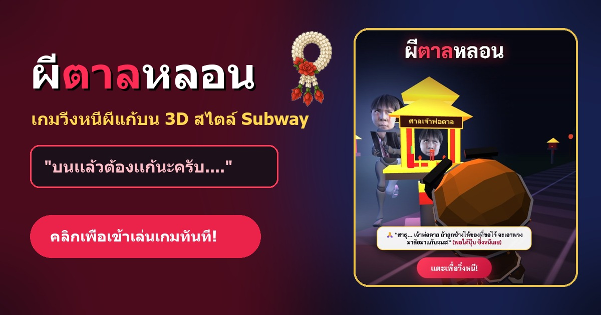
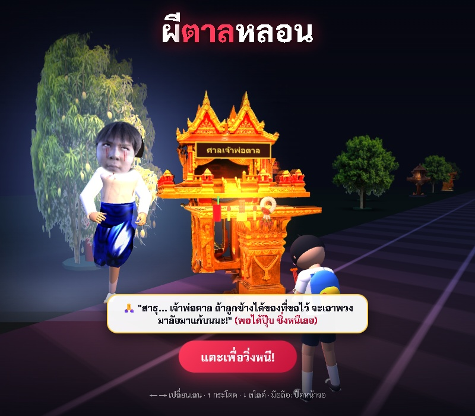
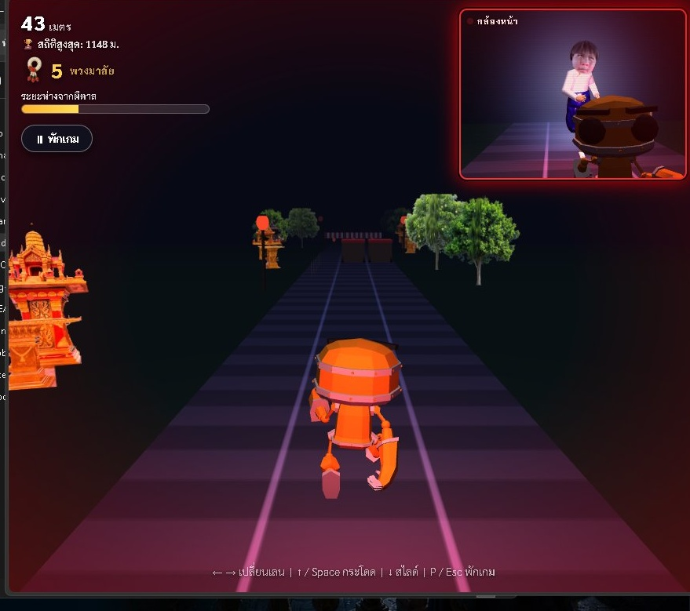
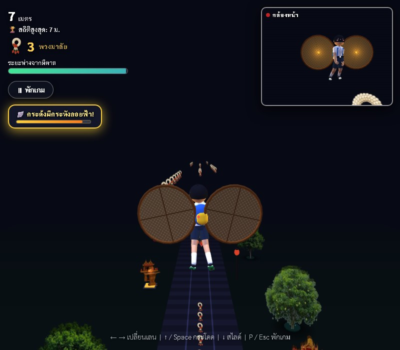

<div align="center">

<a href="https://sub-tan.onrender.com" target="_blank">
  
</a>

# 👻 ผีตาลหลอน Beta (Sub-Tan Beta)
### *3D Endless Runner Web Game — "บนเเล้วต้องเเก้นะครับ...."* 🙏🌼🏃‍♂️💨

<p align="center">
  <a href="https://sub-tan.onrender.com" target="_blank">
    
  </a>
</p>

[](https://sub-tan.onrender.com)
[](https://threejs.org/)
[](https://get.webgl.org/)
[](https://developer.mozilla.org/en-US/docs/Web/API/Web_Audio_API)
[](https://sub-tan.onrender.com)
[](./LICENSE)
[](https://github.com/sanior09)

<br />

<p align="center" style="max-width: 720px; font-size: 16px; line-height: 1.6;">
  <b>ผีตาลหลอน Beta</b> คือเกมวิ่งหนีผี 3 มิติบนเว็บเบราว์เซอร์ สไตล์ <i>Subway Surfers</i><br>
  ที่หยิบยกวัฒนธรรมความเชื่อพื้นบ้านไทยเรื่อง <b>"การบนบานศาลกล่าว"</b> มาสร้างเป็นเกมแอ็กชันสุดระทึกและฮาแบบจัดเต็ม!<br>
  เมื่อคุณไปก้มกราบขอพรหน้า <b>"ศาลเจ้าพ่อตาล"</b> จนสมหวังในสิ่งที่ขอ แต่ดันชิ่งหนีไม่ยอมเอาพวงมาลัยไปแก้บนตามสัญญา...<br>
  งานนี้ <b>เจ้าพ่อตาล</b> เลยต้องกระโดดออกจากศาล สับตีนแตกวิ่งไล่ทวงแก้บนด้วยตัวเองแบบหายใจรดต้นคอ!
</p>

</div>

---

## 📸 ภาพตัวอย่างภายในเกม (Gameplay Showcase)

<table align="center" width="100%">
  <tr>
    <td align="center" width="25%">
      
      <br /><br />
      <b>⛩️ ฉากเปิดไหว้ศาลเจ้าพ่อตาล</b><br>
      <sub>น้องนักเรียนก้มกราบขอพรหน้าศาลพระภูมิสีทองคู่ พร้อมเครื่องเซ่นแฟนต้าแดง พวงมาลัย และผีตาลยืนจ้อง</sub>
    </td>
    <td align="center" width="25%">
      
      <br /><br />
      <b>🏃‍♂️ วิ่ง 3 เลน & กล้องหลัง PiP</b><br>
      <sub>สับตีนแตกหลบสิ่งกีดขวาง เก็บพวงมาลัยมะลิ พร้อมหน้าต่างกล้องหลังส่องผีตาลวิ่งกวดตามแบบเรียลไทม์</sub>
    </td>
    <td align="center" width="25%">
      
      <br /><br />
      <b>🪽 กระด้งผีกระหังลอยฟ้า!</b><br>
      <sub>กระพือปีกกระด้งทะยานขึ้นฟ้า บินหลบผีตาล พร้อมโยกเลนเลี้ยวซ้าย-ขวาเก็บริบบิ้นพวงมาลัยกลางเวหา</sub>
    </td>
    <td align="center" width="25%">
      
      <br /><br />
      <b>😱 ผีตาลจับได้แล้ว!</b><br>
      <sub>ฉาก Jump Scare หน้าตาลเหลือกตาพุ่งขึ้นเต็มจอ รายงานสถิติระยะทาง พร้อมปุ่ม "🔄 แก้บนใหม่" และปุ่ม "🏠 กลับสู่เมนู"</sub>
    </td>
  </tr>
</table>

---

## ✨ จุดเด่นและระบบการเล่น (Key Features)

- ⛩️ **ฉากเปิดเรื่องสุดเข้มข้น (Subway Surfers Cinematic Intro):**
  - เริ่มต้นเกมด้วยคัตซีนหน้า **ศาลพระภูมิทรงจตุรมุขสีทองคู่** ประดับป้ายชื่อ *"ศาลเจ้าพ่อตาล"* แท่นบูชาหน้าศาลมีกระถางธูปจุดควันโขมง น้ำแดงแฟนต้าพร้อมหลอดดูด เทียนคู่ และพวงมาลัยดอกมะลิสด
  - ตัวละครเด็กนักเรียนนั่งพนมมือกราบขอพร พอแตะหน้าจอเพื่อเริ่มเกม ตัวละครจะกระโดดหันหลังสับตีนแตกวิ่งหนีทันที!

- 🏃‍♂️ **ตัวละครเอก "เด็กนักเรียนประถมไทย 3D" สุดน่ารัก:**
  - ดีไซน์ 3D โครงสร้างสัดส่วนการ์ตูนตัวเล็ก สวมเครื่องแบบนักเรียนไทยคอปกขาว กางเกงสีกรมท่า เข็มขัดหัวโลหะ ถุงเท้าขาว และรองเท้านักเรียนนันยาง
  - ทรงผมกะลาครอบ (Bowl Cut) รอบศีรษะพร้อมปอยผมกระดก และกระเป๋าเป้นักเรียนสะพายหลังสีน้ำเงิน-เหลืองพร้อมพวงกุญแจห้อยกระเป๋า
  - แอนิเมชันวิ่งแบบ Continuous Loop สมูทไม่มีกระตุก พร้อมการปรับสปีดและจัดท่าทางกลางอากาศตอนกระโดดอย่างเป็นธรรมชาติ

- 🪽 **ไอเทมพาวเวอร์อัพ "กระด้งผีกระหังลอยฟ้า" (Golden Krahang Flight System):**
  - สุ่มเกิดไอเทม **กระด้งไม้ไผ่สานผีกระหัง** หมุนลอยเด่นพร้อมวงแหวนเวทมนตร์สีทองอร่ามบนรางวิ่ง
  - เมื่อวิ่งเข้าเก็บ ปีกกระด้งคู่จะติดตั้งที่ท่อนแขนทันที พร้อมแอนิเมชันกระพือปีกโบยบินพาตัวละครพุ่งทะยานสู่ท้องฟ้าสีคราม!
  - **แนวริบบิ้นพวงมาลัยกลางเวหา (Sky Garland Ribbon):** บนท้องฟ้าจะมีแถวพวงมาลัยดอกมะลิทอดยาวเป็นคลื่นเลี้ยวซ้าย เลี้ยวขวา สลับเลน ให้ผู้เล่นโยกหลบและเลี้ยวเก็บทำแต้มโบนัสได้อย่างจุใจ
  - ลอยตัวเหนือสิ่งกีดขวางและผีตาลด้านล่างอย่างปลอดภัย 100% พร้อมแถบเกจนับถอยหลังสีทองประกาย (`#ffd23a`)
  - เมื่อเวลาการบินหมด ตัวละครจะค่อยๆ ร่อนตัวลงสู่พื้นดินอย่างนุ่มนวล พร้อมระบบป้องกันการกระแทก (Landing Grace Period) ทันที

- 🧵 **ไอเทมป้องกัน "สายสิญจน์มงคล" (Holy Thread Shield):**
  - วงแหวนบาเรียศักดิ์สิทธิ์ 3 มิติทรงกลมหมุนรอบตัวละคร เปล่งออร่าแสงสีฟ้ามงคล Cyan (`#67e8f9`)
  - **เกราะป้องกันการชน 100%:** คุ้มกันการชนสิ่งกีดขวางทุกชนิดได้ 1 ครั้ง โดยความเร็วไม่ตก ไม่สะดุด และผีตาลไม่สามารถเข้าใกล้ได้
  - แสดงผลระยะเวลานาน 20 วินาที พร้อมแถบเกจนับถอยหลังแบบเรียลไทม์ และระบบกะพริบแจ้งเตือนล่วงหน้าเมื่อเหลือเวลา 3.5 วินาทีสุดท้ายก่อนบาเรียสลายตัว

- 🥤 **ไอเทมเพิ่มความเร็ว "น้ำแดงแฟนต้าติดสปีด" (Fanta Nitro Boost):**
  - โมเดลขวดน้ำแดงแฟนต้า 3 มิติ (3D Cross-Quad Sprite) ลอยหมุนเด่นเป็นสง่าอยู่บนเลนวิ่ง
  - ซดแล้วเข้าสู่โหมดสปีดขั้นสุด เปล่งออร่าประกายส้ม/แดงนีออน Nitro (`#ef4444` พร้อมสตรีมแสง `#ff8800` และ `#ffaa22`) ขนาบข้างลำตัว 6 เส้น
  - วิ่งฝ่าและพุ่งทะลวงสิ่งกีดขวางแตกกระจายโดยไม่ต้องสะดุด พร้อมมุมกล้อง Dynamic FOV ซูมพุ่งทะยานเป็นเวลา 7.5 วินาที

- 📊 **ระบบถาดแสดงสถานะพาวเวอร์อัพดีไซน์กะทัดรัด (Compact Power-up Tray):**
  - จัดวางอย่างมีระดับไว้ใต้กรอบ **กล้องหน้า (PiP Camera)** ทางฝั่งขวาบนของหน้าจอ ช่วยเปิดทัศนวิสัยของเลนวิ่งด้านล่างให้โล่งโปร่งสบายตา 100% หมดปัญหา HUD บดบังสิ่งกีดขวาง
  - รูปทรงแคปซูลแก้วนีออนกึ่งโปร่งใส (Glassmorphic Pill) ขนาดกะทัดรัด (สูงเพียง ~28px) แยกสีและไอคอนตามพลังอย่างชัดเจน:
    - 🧵 **สายสิญจน์:** ออร่าฟ้ามงคล Cyan (`#67e8f9`)
    - 🥤 **แฟนต้าสปีด:** ออร่าส้ม/แดงนีออน Nitro (`#ef4444`)
    - 🪽 **กระด้งบิน:** ออร่าทองประกาย (`#ffd23a`)
  - แสดงเลขนับถอยหลังวินาทีคมชัด (`20s`, `7s`, `8s`) แถบหลอดพลังงาน 4px และระบบแอนิเมชันกะพริบเตือนก่อนหมดเวลา

- 👻 **บอส "ผีตาล" 3D แบบเต็มตัว (Full-Body Rigged Skeleton):**
  - โครงกระดูกมนุษย์ 3 มิติ สวมเสื้อยืดคอกลมสีขาวและกางเกงโจงกระเบนผ้าไหมสีน้ำเงินเข้ม
  - เทคโนโลยี **Bone-Local Inverse Transform Rigging** ขจัดปัญหาข้อต่อแขนขาหลุดได้อย่างสมบูรณ์แบบ แขนขาแนบสนิทไปตามโครงกระดูกตลอดเวลา
  - ดวงตาแดงก่ำพร้อมคราบเลือดไหลอาบแก้ม วิ่งสับขาไล่กวดตามผู้เล่นแบบติดๆ

- 👁️ **ระบบผียืนดักระหว่างทาง (In-Lane & Roadside Ghost Ambush):**
  - มีเงาวิญญาณผีตาลยืนดักกวักมือลอยตัวขวางเลนอยู่ระหว่างทางตลอดเส้นทาง พร้อมดวงตาสีแดงฉานและไอวิญญาณสีเลือดใต้ฝ่าเท้า!
  - **ระบบสุ่มระยะห่างที่ปลอดภัย (Fair Spacing Protocol):** ควบคุมระยะห่างระหว่างจุดดัก 55–100 เมตร เพื่อให้ผู้เล่นมองเห็นล่วงหน้าและมีเวลาตัดสินใจโยกเลนหลบได้อย่างแน่นอน
  - **การันตีเลนหนีรอด (Guaranteed Escape Route):** เมื่อผีตาลยืนดักในเลนใด เลนข้างเคียงจะเปิดโล่งให้หลบอย่างปลอดภัย พร้อมแนวพวงมาลัยดอกมะลิให้เก็บทำคะแนน
  - มีเสียงเฉียดผี (Whoosh Whisper) เมื่อโยกหลบผ่านได้สำเร็จ และฉาก Jump Scare จอแดงหากเผลอวิ่งชนผีที่ยืนดัก!

- 📹 **ระบบกล้องส่องหลังแบบเรียลไทม์ (PiP Rearview Camera):**
  - หน้าต่าง Picture-in-Picture มุมขวาบนทำหน้าที่เป็นกระจกมองหลัง ส่องภาพผีตาลที่กำลังวิ่งไล่กวดมาด้านหลังแบบสดๆ
  - มีไฟสถานะกระพริบเตือนภัยสีแดง (Alert Pulse) เมื่อผีตาลขยับเข้ามาใกล้ในระยะอันตราย
  - รองรับการปรับมุมกล้องยกสูงขึ้นตอนบินกระด้งผีกระหัง ให้เห็นผีตาลแหงนมองตาค้างอยู่ข้างล่างแบบสะใจ!

- 😱 **ระบบ Jump Scare หน้าตาลขึ้นเต็มจอ (Full-Screen Death Scare):**
  - เมื่อโดนผีตาลจับได้ หน้าผีตาลตัวจริงพร้อมสายตาเหลือกอันเป็นเอกลักษณ์จะ **พุ่งกระแทกตาขึ้นเต็มจอ 100% ทันที**
  - เสริมความหลอนด้วยแอนิเมชันหน้าสั่นกระตุก (`scareShake`), ขอบจอดำแดงระอุเลือด และเสียงกรีดร้องสยองขวัญ
  - เมื่อผ่านช่วงความหลอน ~1.6 วินาที หน้าจอจะค่อยๆ สลับเป็นการ์ดสรุปสถิติคะแนน พร้อมปุ่ม **"🔄 แก้บนใหม่"** และปุ่ม **"🏠 กลับสู่เมนู"** ให้เลือกเล่นต่อได้ทันที!

- 🌼 **ระบบเก็บพวงมาลัยดอกมะลิ & ตัวเร่งสปีด:**
  - เก็บ **พวงมาลัยดอกมะลิ 3D** ตามเลนวิ่งเพื่อทำแต้มและช่วยทิ้งระยะห่างจากผีตาล
  - หากวิ่งชนสิ่งกีดขวาง (คานไม้, กล่องไม้, สิ่งกีดขวางริมทาง) ความเร็วจะตกและผีตาลจะวาร์ปพุ่งเข้าประชิดตัวทันที!

- 🔊 **ระบบเสียงสังเคราะห์ Web Audio API 100% (Zero-Asset Audio):**
  - เสียงฝีเท้าวิ่งสลับซ้าย-ขวา
  - เสียงหัวใจเต้นตึกตัก (**Dynamic Heartbeat Engine**) ที่จะเร่งจังหวะ BPM ถี่ขึ้นเรื่อยๆ ตามความใกล้ของผีตาล
  - เสียงกระดิ่งพวงมาลัยใสหวาน และเสียง Jump Scare สังเคราะห์ความถี่ต่ำสุดสะพรึง
  - **ไม่ต้องโหลดไฟล์ MP3 ภายนอกแม้แต่ไฟล์เดียว** ช่วยให้โหลดเกมติดสปีดทันที

- ⚡ **Zero-Dependency & Pure WebGL:**
  - โค้ดทั้งหมดรันด้วย Vanilla JavaScript + Three.js
  - ไม่มี Build Step, ไม่ต้องพึ่งพา Node.js / NPM และเปิดเล่นได้ทันทีแบบ Offline หรือผ่านเบราว์เซอร์

---

## 🎮 วิธีการบังคับ (Game Controls)

รองรับทั้งคีย์บอร์ดคอมพิวเตอร์และระบบสัมผัสบนสมาร์ทโฟน / แท็บเล็ตอย่างสมบูรณ์แบบ:

| การเคลื่อนไหว (Action) | 💻 คอมพิวเตอร์ (Keyboard) | 📱 มือถือ / แท็บเล็ต (Touch Screen) |
| :--- | :---: | :---: |
| **เริ่มเกม / วิ่งหนี** | `คลิกเมาส์` หรือกด `Spacebar` / `Enter` | `แตะที่หน้าจอ (Tap)` |
| **โยกหลบซ้าย (Lane Left)** | ปุ่มลูกศร `←` หรือกด `A` | `ปัดนิ้วไปทางซ้าย (Swipe Left)` |
| **โยกหลบขวา (Lane Right)** | ปุ่มลูกศร `→` หรือกด `D` | `ปัดนิ้วไปทางขวา (Swipe Right)` |
| **กระโดดข้ามสิ่งกีดขวาง (Jump)** | ปุ่มลูกศร `↑` / `W` / `Spacebar` | `ปัดนิ้วขึ้น (Swipe Up)` |
| **สไลด์มุดลอดคาน (Slide)** | ปุ่มลูกศร `↓` หรือกด `S` | `ปัดนิ้วลง (Swipe Down)` |
| **พักเกม / หยุดชั่วคราว (Pause)** | กดปุ่ม `P` หรือคลิกปุ่ม `พักเกม` บนจอ | `แตะปุ่มพักเกม` |

---

## 🗂️ โครงสร้างไฟล์ในโปรเจกต์ (Project Directory)

```text
sub-tan/
├── index.html          # โครงสร้างหน้าเว็บหลัก, HUD, กรอบกล้อง PiP และระบบเมนู UI
├── game.js             # เกมลูป 3D, ฉากศาลเจ้าพ่อตาล, ระบบเจนเนอเรตสิ่งกีดขวาง, ฟิสิกส์ และ WebAudio API
├── character.js        # สถาปัตยกรรมโมเดล 3D: เด็กนักเรียนไทยประถม และผีตาลแบบ Rigged Bones
├── robot.js            # ไฟล์โมเดล GLB เวกเตอร์ 3D สำรอง
├── xbot.js             # โครงสร้างกระดูกมนุษย์ 3D (Humanoid Skeleton & Animations)
├── render.yaml         # ไฟล์คอนฟิกอัตโนมัติสำหรับการ Deploy บน Render Static Site
├── LICENSE             # ใบอนุญาตการใช้งานโค้ดแบบ MIT License
├── lib/
│   ├── three.min.js    # Three.js 3D Engine (r147)
│   └── GLTFLoader.js   # โมดูลโหลดแอนิเมชันและโครงกระดูก 3D GLTF/GLB
└── Image/              # แหล่งรวม Asset รูปภาพและเท็กซ์เจอร์ทั้งหมด
    ├── tan-face.jpg    # ภาพถ่ายใบหน้าต้นฉบับของผีตาล
    ├── shirt-tex.png   # เท็กซ์เจอร์เสื้อยืดผีตาล
    ├── chong-tex.png   # เท็กซ์เจอร์โจงกระเบนลายไทยสีน้ำเงิน
    ├── garland.png     # เท็กซ์เจอร์พวงมาลัยดอกมะลิแก้บน
    ├── fanta.png       # เท็กซ์เจอร์ภาพขวดน้ำแดงแฟนต้าเซ่นไหว้
    ├── shrine1.png     # ภาพศาลไม้สักทรงไทยโบราณ
    ├── shrine2.png     # ภาพศาลพระภูมิสีทองยอดแหลม
    ├── shrine3.png     # ภาพศาลเจ้าพ่อตาลสีทองคู่
    ├── tree1.png       # เท็กซ์เจอร์ต้นไม้ใบเขียวชอุ่ม
    ├── tree2.png       # เท็กซ์เจอร์ต้นมะม่วงไทย
    ├── og-banner.jpg   # แบนเนอร์หลักสำหรับ OpenGraph Social Preview (1200x630)
    ├── favicon.png     # ไอคอนเว็บ Favicon ขนาด 32x32 / 64x64
    ├── face.js         # ข้อมูลเท็กซ์เจอร์ใบหน้าและพวงมาลัยแบบ Base64 สำหรับ Standalone Run
    └── scenery.js      # ข้อมูลเท็กซ์เจอร์ศาลและต้นไม้แบบ Base64 สำหรับ Standalone Run
```

---

## 🛠️ วิธีการรันบนเครื่องของคุณ (Local Development)

เนื่องจากโปรเจกต์นี้สร้างขึ้นด้วยสถาปัตยกรรม **Zero-Dependency Static Web** จึงสามารถรันได้ทันทีโดยไม่ต้องรัน `npm install`:

### วิธีที่ 1: ดับเบิลคลิกเปิดไฟล์ได้ทันที (Zero Setup)
1. โคลนคลังโค้ดลงเครื่อง:
   ```bash
   git clone https://github.com/sanior09/sub-tan.git
   cd sub-tan
   ```
2. ดับเบิลคลิกที่ไฟล์ `index.html` เพื่อเปิดเล่นผ่านเบราว์เซอร์คู่ใจ (Chrome, Edge, Safari, Firefox) ได้ทันที!

### วิธีที่ 2: รันผ่าน Local Web Server (แนะนำ)
หากต้องการทดสอบผ่านเซิร์ฟเวอร์แบบเดียวกับ Production สามารถใช้คำสั่งเบาๆ ผ่าน Command Line / Terminal:

- **ผ่าน Python 3:**
  ```bash
  python -m http.server 8080
  # จากนั้นเปิดเบราว์เซอร์ไปที่ http://localhost:8080
  ```
- **ผ่าน Node.js (npx):**
  ```bash
  npx serve .
  ```
- **ผ่าน VS Code:** คลิกขวาที่ไฟล์ `index.html` แล้วเลือก **"Open with Live Server"**

---

## 🗺️ แผนการพัฒนาในอนาคต (Roadmap)

- [x] ฉากเปิดกราบศาลเจ้าพ่อตาล พร้อมเครื่องเซ่นไหว้ (Subway Surfers Intro)
- [x] ปรับเปลี่ยนตัวละครผู้เล่นเป็นเด็กนักเรียนไทย 3D ชุดนักเรียนน่ารัก
- [x] ยกระดับโมเดลศาลพระภูมิและต้นไม้ริมทางเป็นสไตล์ไทยแท้ 3 มิติ
- [x] เพิ่มปุ่มลัดกลับสู่หน้าเมนูหลักทั้งตอนจบเกมและหน้าต่างพักเกม
- [x] ไอเทมพาวเวอร์อัพ "กระด้งผีกระหังลอยฟ้า" พร้อมริบบิ้นพวงมาลัยกลางเวหา (Subway Surfers Jetpack)
- [x] ระบบผีตาลยืนดักกวักมือขวางเลนระหว่างทาง พร้อมระยะห่างที่ปลอดภัย (Fair Spacing)
- [x] ระบบ Jump Scare หน้าตาลเหลือกตาขึ้นเต็มจอ พร้อมปุ่ม "🔄 แก้บนใหม่" และ "🏠 กลับสู่เมนู"
- [x] โลโก้และแบนเนอร์เวอร์ชัน Beta อย่างเป็นทางการ
- [x] ถาดแสดงสถานะพาวเวอร์อัพดีไซน์กะทัดรัด (Compact Power-up Tray) จัดวางใต้กล้องหน้า PiP ไม่บดบังเลนวิ่ง
- [ ] 🥤 **ไอเทมพิเศษระหว่างทาง:**
  - [x] 🥤 **น้ำแดงแฟนต้าติดสปีด (Fanta Nitro Dash):** ซดแล้วติดสปีดความเร็วสูง พุ่งทะลวงชนสิ่งกีดขวางแตกกระจาย 7.5 วินาที พร้อมรับพวงมาลัยโบนัส
  - [x] 🧵 **สายสิญจน์มงคล (Holy Thread Shield):** บาเรียคุ้มกันศักดิ์สิทธิ์ ชนสิ่งกีดขวางได้ 1 ครั้งโดยความเร็วไม่ตก ไม่สะดุด และผีตาลไม่เข้าใกล้
  - *สเก็ตบอร์ดไม้ไผ่:* สเก็ตบอร์ดวิ่งหนีผี หมุนตัวกลางอากาศ 360 องศา
- [ ] 🏆 **ระบบกระดานผู้นำออนไลน์ (Global Leaderboard):** บันทึกคะแนนและระยะทางสูงสุด
- [ ] 🔐 **ระบบล็อกอินเก็บสถิติ (User Account & Stats):** สมัครสมาชิกและเข้าสู่ระบบเพื่อบันทึกสถิติการเล่นส่วนตัว (ระยะทางสูงสุด, จำนวนพวงมาลัยสะสม, สถิติการวิ่ง) พร้อมซิงก์ข้อมูลข้ามอุปกรณ์
- [ ] 🎭 **ระบบปลดล็อกสกินตัวละคร:** เช่น สกินชุดลูกเสือ, สกินชุดไทยโบราณ, สกินเด็กแว้น

---

## 📜 ลิขสิทธิ์และความเป็นเจ้าของ (Ownership & License)

- **ผู้สร้างและพัฒนาโปรเจกต์ (Creator & Developer):** [**@sanior09**](https://github.com/sanior09)
- **สัญญาอนุญาต (License):** เผยแพร่ภายใต้สัญญาอนุญาตแบบ [**MIT License**](./LICENSE) — สามารถนำไปศึกษา ดัดแปลง หรือต่อยอดเชิงสร้างสรรค์ได้ตามอัธยาศัย โดยระบุเครดิตเจ้าของโค้ดเดิม

<br />

<div align="center">
  <sub>Made with ❤️, Thai Wit & Three.js WebGL Engine</sub><br />
  <b>⚠️ คำเตือนจากเจ้าพ่อตาล: บนอะไรไว้ อย่าลืมเอาพวงมาลัยไปแก้บนนะครับ.....</b>
</div>
